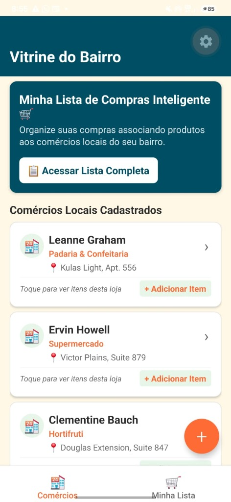
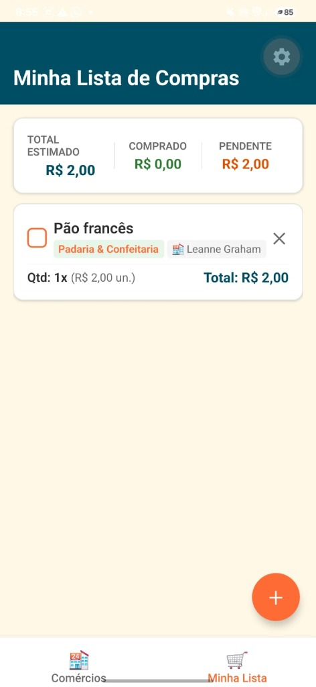
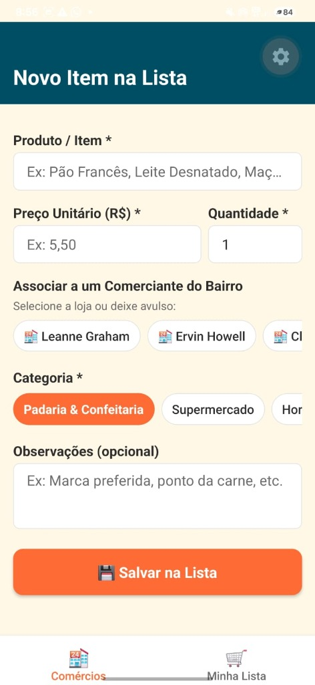
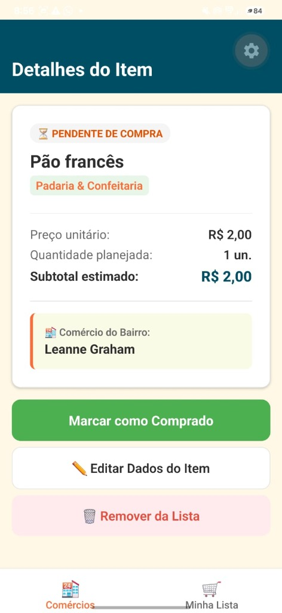

# Vitrine do Bairro - Minha Lista de Compras Inteligente (AV2)

Aplicativo mobile desenvolvido em **React Native + Expo** com **TypeScript** para o **Desafio Prático Individual (AV2)** da disciplina de **Programação para Dispositivos Móveis**.

---

## Identificação do Aluno
- **Nome:** Carlos Alberto Yuiti Yamada
- **RA:** 1710482421005

---

## Sobre o Aplicativo
O **"Minha Lista de Compras Inteligente"** auxilia os moradores do bairro a organizar suas compras de forma prática, conectando seus itens aos comércios locais cadastrados na **Vitrine do Bairro** (padarias, mercados, fruteiras, açougues e farmácias).

### Funcionalidades Implementadas
- [x] **Cadastro e Edição de Itens:** Adicione produtos com nome, preço unitário, quantidade, categoria e observações.
- [x] **Associação ao Comércio Local:** Associe cada produto diretamente a um comerciante do bairro (ex: Seu Zé, Hortifruti da Terra).
- [x] **Status "Comprado" / Pendente:** Marque itens como comprados diretamente na lista ou na tela de detalhes com feedback visual instantâneo.
- [x] **Cálculo do Total Estimado:** Exibição em tempo real do **Total Estimado da Compra**, **Total Já Comprado** e **Total Pendente**.
- [x] **Persistência Offline-First:** Salva localmente via `@react-native-async-storage/async-storage`. Funciona 100% offline com cache inteligente dos dados da API.
- [x] **Navegação Completa e Parâmetros:** Navegação fluida com React Navigation (Tabs + Stack), passagem de parâmetros (`productId`, `businessId`, `businessName`) e Safe Areas respeitadas.
- [x] **Validação com Feedback Visual:** Campos obrigatórios validados com bordas e alertas em vermelho e botões de desativação durante requisições.

---

## Estrutura do Projeto

O projeto segue estritamente a separação em camadas solicitada:

```
vitrine-do-bairro-av2/
├── assets/             # Ícones e recursos visuais
├── src/
│   ├── components/     # Componentes reutilizáveis (ProductCard, Header)
│   ├── hooks/          # Custom Hook (useShoppingList - estado e regras de negócio)
│   ├── navigation/     # Configuração de rotas (Stack Navigator e Bottom Tabs)
│   ├── screens/        # Telas da aplicação
│   │   ├── HomeScreen.tsx           # Lista dos comércios locais (Vitrine)
│   │   ├── ProductListScreen.tsx    # Minha Lista de Compras + Resumo Financeiro
│   │   ├── ProductFormScreen.tsx    # Cadastro e edição com validações
│   │   └── ProductDetailScreen.tsx  # Detalhes do item e ações rápidas
│   ├── services/       # Persistência e comunicação externa
│   │   ├── api.ts                   # Integração REST com fallback offline
│   │   └── storage.ts               # Armazenamento AsyncStorage
│   ├── theme/          # Paleta de cores e espaçamentos padronizados
│   └── types/          # Interfaces TypeScript completas
├── App.tsx             # Ponto de entrada com SafeAreaProvider e AppNavigator
└── package.json
```

---

## Tecnologias Utilizadas
- **React Native 0.88** & **Expo SDK 58**
- **TypeScript 6.0** (Tipagem estrita para todas as interfaces e navegações)
- **React Navigation 7** (`@react-navigation/native`, `@react-navigation/native-stack`, `@react-navigation/bottom-tabs`)
- **AsyncStorage** (`@react-native-async-storage/async-storage`)
- **Safe Area Context** (`react-native-safe-area-context`)

---

## Como Rodar o Projeto

### Pré-requisitos
- **Node.js** (versão 20 ou 22 recomendada)
- **Expo Go** instalado no celular Android ou iOS

### Passo a Passo
1. Clone ou acesse o repositório do projeto:
   ```bash
   cd vitrine-do-bairro-av2
   ```

2. Instale as dependências:
   ```bash
   npm install
   ```

3. Inicie o servidor Expo:
   ```bash
   npx expo start
   ```

4. **Executar no Celular:**
   - Abra o aplicativo **Expo Go** no seu smartphone.
   - Escaneie o QR Code exibido no terminal.
   - Se preferir rodar no emulador:
     - Digite `a` para Android Emulator.
     - Digite `w` para abrir na Web.

---

## Screenshots
*(Tire capturas de tela do app rodando no Expo Go e adicione nesta seção caso desejado)*
- Tela Inicial (Vitrine de Comércios)

- Tela Minha Lista de Compras com Totais Calculados

- Tela de Cadastro com Validação de Erros

- Tela de Detalhes do Item

